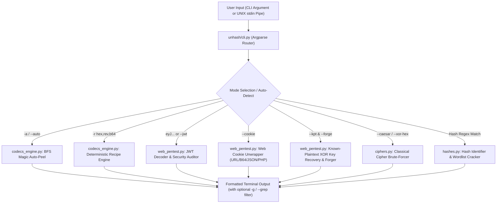

# 🔪 unhash — Zero-Dependency CLI Decoder & Web Pentest Inspector

**`unhash`** is a fast, zero-dependency command-line tool built for **CTF players and Web Penetration Testers**. Inspired by *CyberChef* and created as a modern, lightweight successor to the archived *Ciphey* project, `unhash` runs on **100% pure Python Standard Library** (Python 3.8 – 3.13+) with zero installation friction.

> **Cryptographic Note:** While cryptographic hashes are mathematically one-way functions, `unhash` unifies **automated multi-layer encoding unwrapping (BFS Magic Mode)**, **Web Cookie & JWT Security Auditing**, **Known-Plaintext XOR Key Recovery & Cookie Forgery**, and **Hash Identification + Dictionary Cracking** into a single UNIX CLI command.

---

## 🏗️ System Architecture & Project Structure

### 1. Execution Flow Diagram


### 2. Directory Layout
```text
unhash/
├── pyproject.toml          # Package metadata & registers the global 'unhash' CLI entry point
├── README.md               # Project documentation, architecture, and usage examples
├── .gitignore              # Excludes Python cache, build artifacts, and virtualenvs
├── unhash/                 # Core application package (100% Pure Python Stdlib)
│   ├── __init__.py         # Package version definition
│   ├── cli.py              # CLI router, argument parser, UNIX pipe reader, and ANSI formatter
│   ├── codecs_engine.py    # Multi-layer BFS Auto-Peel & Recipe decoders (Hex, B64, B32, URL, Bin, Rev)
│   ├── web_pentest.py      # JWT Security Auditor, Cookie Inspector, & Known-Plaintext XOR Forger
│   ├── ciphers.py          # Caesar/ROT (1-25) & Single-Byte XOR (0x01-0xFF) brute-force engines
│   └── hashes.py           # Regex hash identifier (MD5, SHA1, SHA256, Bcrypt) & dictionary cracker
└── tests/
    └── test_all.py         # Automated unit tests (Natas 8, Natas 11 XOR Forgery, JWT Audit)
```

---

## ✨ What Makes `unhash` Different?
1. **Zero External Dependencies**: Unlike `Ciphey` (archived & broken on Python 3.11+), `unhash` uses pure Python stdlib and installs anywhere in 1 second.
2. **Web Pentest Native (Burp Suite Companion)**:
   - **JWT Auto-Inspector & Auditor (`--jwt`)**: Decodes claims and flags `alg: none` or privilege escalation fields (`admin`, `role`).
   - **Web Cookie Unwrapper (`--cookie`)**: Peels `URL-Encode` + `Base64` + `JSON` / `PHP serialize()` cookies.
   - **Known-Plaintext XOR Cracker & Forger (`--kpt` & `--forge`)**: Automatically recovers repeating XOR keys and forges new payloads (solves challenges like *OverTheWire Natas 11* in one command).
3. **Magic Auto-Peel (`-a`) & Deterministic Recipes (`-r`)**: Peels nested encodings via Breadth-First Search or deterministic recipes (`hex,rev,b64`).

## 🚀 Quick Install
```bash
git clone https://github.com/nauxeuphy/unhash.git
cd unhash
pip install -e .
```

## 💻 Usage Examples

### 1. Magic Auto-Peel (e.g., OverTheWire Natas 8)
```bash
unhash 3d3d516343746d4d6d6c315669563362 -a
```
Output:
```text
  Chain #2:
    ├─► [Layer 1: Hex Decode] ==QcCtmMml1ViV3b
    ├─► [Layer 2: Reverse String] b3ViV1lmMmtCcQ==
    └─► [Layer 3: Base64 Decode] oubWYf2kBq
```

### 2. Known-Plaintext XOR Key Recovery & Cookie Forgery (e.g., OverTheWire Natas 11)
```bash
unhash "ClVLIh4ASCsCBE8lAxMacFMZV2hdVVotEhhUJQNVAmhSEV4sFxFeaAw%3D" \
  --kpt '{"showpassword":"no","bgcolor":"#ffffff"}' \
  --forge '{"showpassword":"yes","bgcolor":"#ffffff"}'
```

### 3. JWT Security Audit
```bash
unhash "eyJhbGciOiJub25lIiwidHlwIjoiSldUIn0.eyJ1c2VyIjoibmF1ZmFsIiwiYWRtaW4iOmZhbHNlfQ."
```
